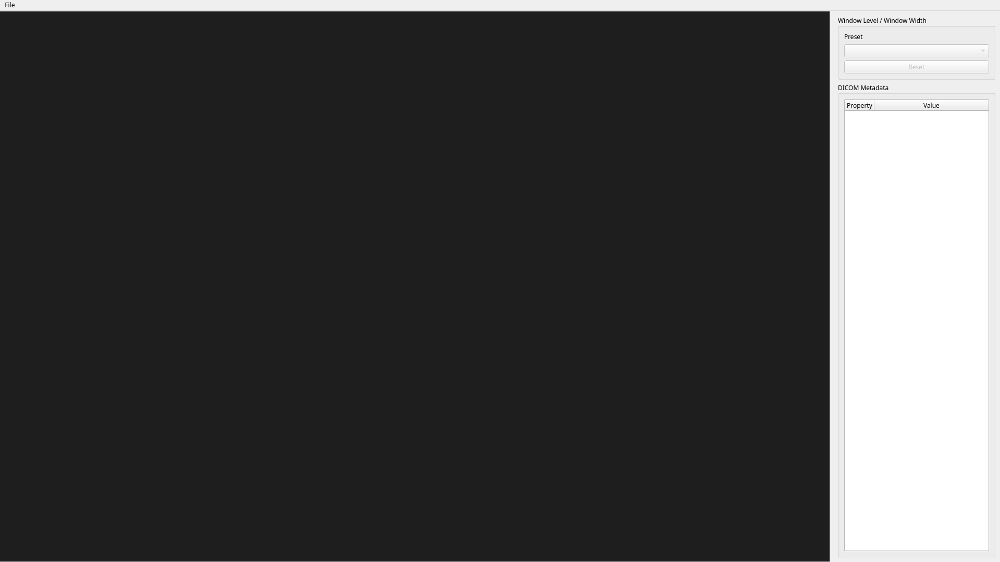
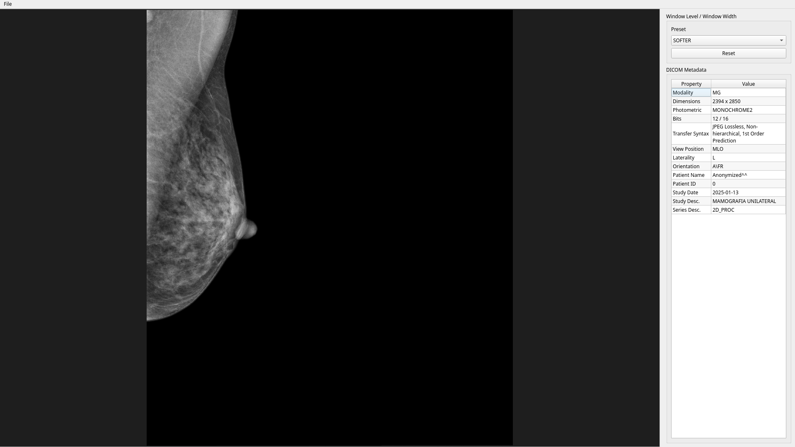
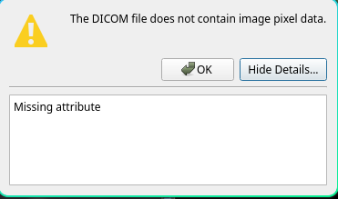

# Visualizador DICOM

Aplicação desktop em **C++17** com **Qt 6 Widgets** e **DCMTK** para visualização de imagens médicas no formato DICOM (`.dcm`).

## Descrição do Projeto

O projeto foi organizado separando estritamente a lógica de domínio DICOM da camada de interface gráfica:

- **Core (`core/`):** biblioteca estática em **C++17 puro**. Encapsula o `DCMTK` via padrão PIMPL (`DicomImage::Impl`), gerencia o registro de codecs via RAII (`CodecGuard`) e concentra toda a decodificação e o processamento de imagem para visualização. O tratamento de erros utiliza `std::variant<..., Error>`, entregando mensagens amigáveis para a interface enquanto preserva os detalhes técnicos separadamente. Também foram implementados testes unitários em `GoogleTest` (`tests/`) usando datasets DICOM gerados em memória, evitando lentidão e dependência de arquivos externos em disco.
- **Interface (`app/`):** aplicação em **Qt 6 Widgets** (`MainWindow`). Oferece seleção de arquivos DICOM pelo explorador nativo do sistema operacional, além da troca de presets de *Window Level / Window Width* e exibição dos metadados da imagem (nome do paciente, data do estudo, dimensões, modalidade, entre outros).

### Funcionalidades Implementadas

#### Escopo Obrigatório
- Seleção de arquivo `.dcm` via diálogo gráfico do sistema (`File → Select image`).
- Carregamento de arquivos DICOM descomprimidos e comprimidos (`JPEG Lossless`, `JPEG-LS` e `RLE`).
- Exibição respeitando as dimensões originais, escala de cinza (`MONOCHROME1` com inversão para exibição e `MONOCHROME2`, 8/12/16 bits com `Rescale Slope / Intercept` e VOI) e orientação espacial.
- Tratamento claro de erros para arquivos inválidos, ausentes ou sem `PixelData`.

#### Diferenciais Opcionais Implementados
- **Window Level / Window Width:** seleção de presets embutidos (`SOFTER`, `NORMAL`, `HARDER`) e botão `Reset`. Controles desabilitados automaticamente quando não há presets ou em imagens coloridas.
- **Exibição de Metadados DICOM:** painel lateral contendo metadados da imagem visualizada.
- **Suporte a Imagens Coloridas:** exibição de imagens `RGB` e `PALETTE COLOR`.

## Capturas de Tela

### Tela Inicial


### Visualização DICOM, Presets de Janela e Metadados


### Tratamento de Erros com Detalhes Técnicos


## Bibliotecas e Dependências

| Componente | Versão | Papel | Observação |
| --- | --- | --- | --- |
| **C++** | C++17 (`CMAKE_CXX_EXTENSIONS OFF`) | Linguagem base | Padrão estrito em todos os targets |
| **Qt (`Qt6::Widgets`)** | **Qt 6.12.0** | Interface gráfica | Deve estar instalado no sistema (`find_package(Qt6)`) |
| **vcpkg** | Modo manifesto (`vcpkg.json`) | Gerenciador de pacotes C++ | **Obrigatório** para instalar `DCMTK` e `GoogleTest` |
| **DCMTK** | **3.7.1** (`dcmtk[zlib]`) | Decodificação DICOM, codecs e VOI | Instalado automaticamente via `vcpkg` |
| **GoogleTest** | **1.18.0** (`gtest`) | Testes unitários do `dicom_core` | Instalado automaticamente via `vcpkg` |
| **CMake** | ≥ 3.21 | Configuração e build | Auto-detecta `$VCPKG_ROOT` e compila em `Release` por padrão |

---

## Estrutura do Projeto

```text
.
├── app/                   # Aplicação Qt 6 Widgets (drtis_viewer)
├── core/                  # Biblioteca C++17 pura de domínio DICOM (dicom_core)
├── tests/                 # Testes unitários GoogleTest e fixtures em memória
├── CMakeLists.txt         # Build raiz (Release por padrão, auto-detecção do vcpkg)
├── CMakePresets.json      # Presets opcionais para IDEs / Ninja
├── vcpkg.json             # Manifesto de dependências (dcmtk[zlib], gtest)
└── vcpkg-configuration.json
```

---

## Pré-requisitos

1. Compilador **C++17** (GCC, Clang ou MSVC)
2. **CMake** ≥ 3.21
3. **Qt 6** (`Widgets`) instalado no sistema *(testado com **Qt 6.12.0**; se estiver em pasta customizada, informe `-DCMAKE_PREFIX_PATH="<caminho-qt6>"`)*
4. **vcpkg (obrigatório):** instale ou clone o [`vcpkg`](https://github.com/microsoft/vcpkg) e defina a variável de ambiente **`VCPKG_ROOT`** apontando para o diretório dele antes de rodar o CMake:
   - Linux/macOS: `export VCPKG_ROOT=/caminho/para/vcpkg`
   - Windows (PowerShell): `$env:VCPKG_ROOT="C:\caminho\para\vcpkg"`

---

## Configuração, Compilação, Testes e Execução

### Compilação Padrão (`Release` automático)

Na primeira execução, o `vcpkg` baixará e compilará automaticamente o `DCMTK` e o `GoogleTest`:

```bash
# 1. Configurar (usa $VCPKG_ROOT e modo Release automaticamente)
cmake -B build

# 2. Compilar
cmake --build build --config Release

# 3. Executar testes unitários
ctest --test-dir build -C Release --output-on-failure

# 4. Executar a aplicação
# Linux / macOS:
./build/app/drtis_viewer
# Windows (Visual Studio):
.\build\app\Release\drtis_viewer.exe
```

#### Opções de Build
- **Modo Debug:** `cmake -B build -DCMAKE_BUILD_TYPE=Debug` *(ou `--config Debug` em geradores multi-config como Visual Studio)*.
- **Somente Core + Testes:** `cmake -B build -DBUILD_GUI=OFF`.
- **Usando `CMakePresets.json`:** presets disponíveis `gui-release`, `gui-debug`, `core-release` e `core-debug` (`cmake --preset gui-release && cmake --build --preset gui-release`).
